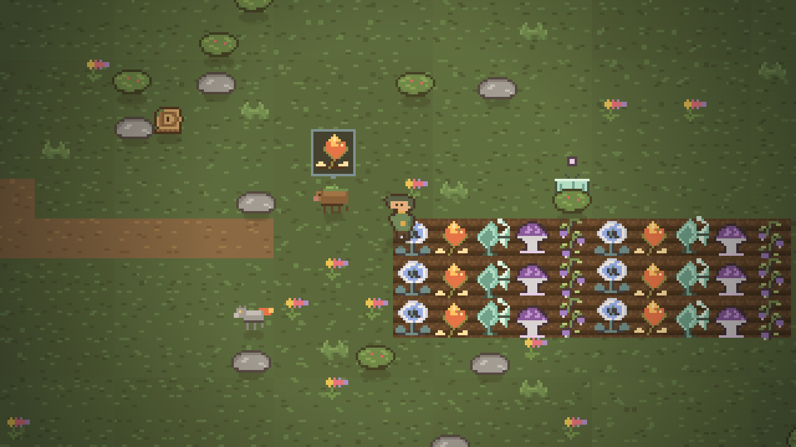
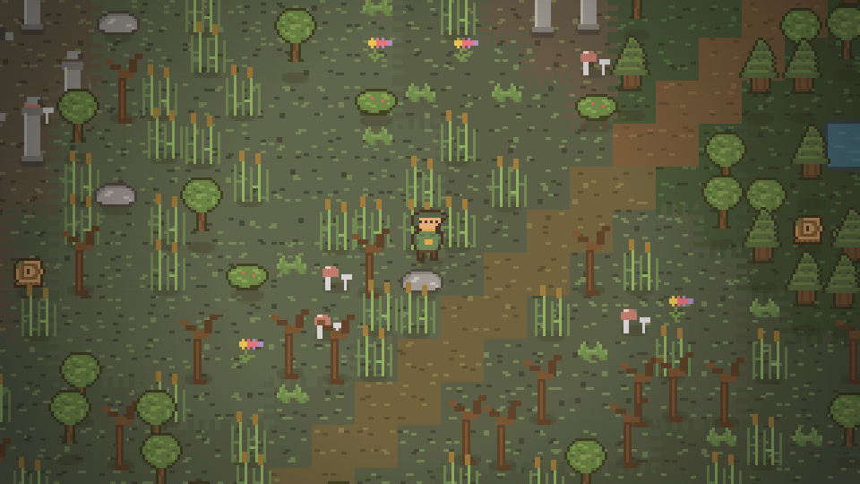
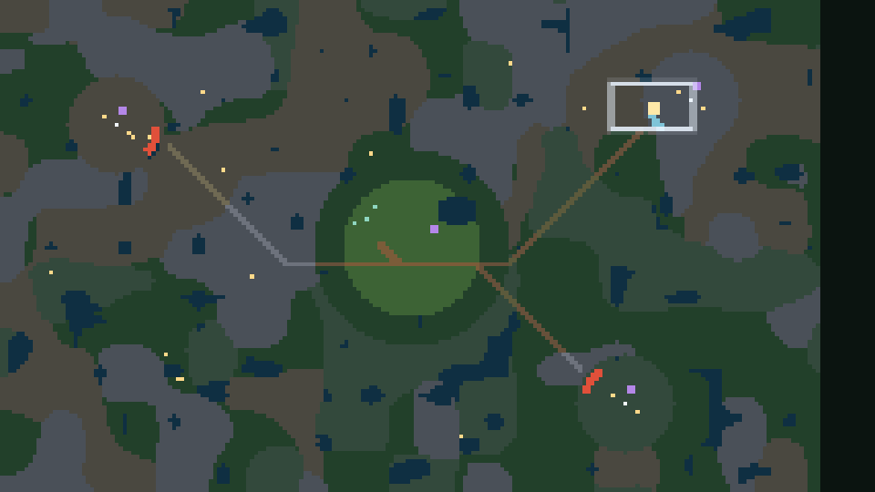
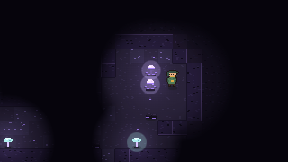
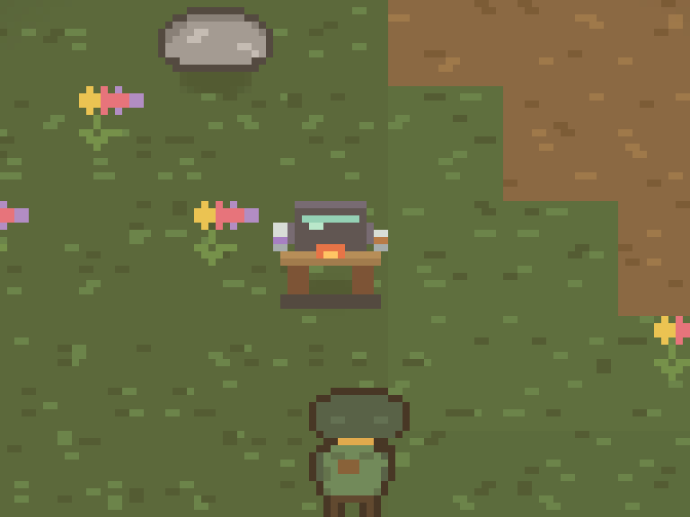
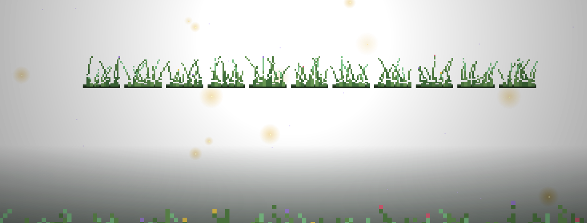

# 🌿 Chimera Grove — web

**Жанр:** 2D pixel art alchemy farming / life sim
**Стек:** TypeScript + Vite + Canvas 2D, без ігрового рушія
**Статус:** світ із п'яти біомів + ферма + лісові духи + Мережа Коренів + алхімічний стіл (п'ятий зріз)

**▶️ Грати в браузері (без встановлення):** <https://nothing12-glitch.github.io/chimera-grove-web/>

Web-версія проєкту [nothing12-glitch/chimera-grove](https://github.com/nothing12-glitch/chimera-grove) (там залишився лише дизайн-конспект для Godot).













---

## ▶️ Запуск

```bash
npm install
npm run dev      # http://localhost:5183
npm run build    # tsc --noEmit + vite build → dist/
npm run typecheck
npm run check:art
npm run check:world   # інваріанти згенерованої карти
npm run check:combat  # інваріанти бою: хит-бокси, нічний спавн, видобуток, бос
npm run check:pack    # кожна клітинка паку, яку просить гра, справді є у png
npm run check:anim    # кожен анімаційний кліп: кадри діляться, спрайт не обрізаний
```

## 🚀 Публікація

`push` у `main` запускає `.github/workflows/pages.yml`: він збирає `dist/` і викладає його на GitHub Pages за адресою <https://nothing12-glitch.github.io/chimera-grove-web/>. Збірка в CI залежить від нативного бінаря `@rollup/rollup-linux-x64-gnu`, тому він закріплений в `optionalDependencies` — lockfile, згенерований на Windows, сам його не додає (npm/cli#4828).

## 🎮 Керування

| Клавіша                | Дія                                                                                             |
| ---------------------- | ----------------------------------------------------------------------------------------------- |
| `WASD` / стрілки       | ходити                                                                                          |
| `1`–`8`, колесо миші   | мотика / лійка / насіння                                                                        |
| `E`, `Пробіл`, `Enter` | дія перед персонажем: розорати, посіяти, полити, набрати води, зібрати, торгувати, варити зілля |
| `F`                    | чекати до світанку                                                                              |
| `M`                    | мапа гаю (рамка навколо тебе показує, що видно на екрані)                                       |
| `H`                    | довідка, `Esc` — закрити                                                                        |

Гра слухає **фізичну клавішу**, а не ту літеру, яку друкує розкладка: на українській `W A S D` — це `г ф і в`, і алхімік таки йде вгору. Те саме для `E`, `F`, `M` та цифр `1`–`8`.

Доба триває **12 справжніх хвилин**: одна секунда реального часу — одна хвилина в гаю (08:00 → 20:00). Хочеш у ніч чи в новий ранок швидше — лягай спати й тисни `F`; годинник тоді переноситься на світанок за півсекунди.

## 🌱 Ігровий цикл

Розорати грядку мотикою → посіяти насіння → полити з лійки → перечекати ніч (`F`) → зібрати врожай → продати на прилавку → купити дорожче насіння.

Рослина отримує **1 очко росту на кожен світанок, якщо в землі є волога**. Волога зникає (`thirst` у кожної культури своя), тому Палаючий Корінь і Шепотна Лоза потребують поливу двічі на добу.

| Культура         | Днів до зрілості | Насіння | Врожай | Особливість           |
| ---------------- | ---------------- | ------- | ------ | --------------------- |
| Місячна Пелюстка | 3                | 12      | 26     | старт гри             |
| Палаючий Корінь  | 6                | 30      | 74     | п'є 2 вологи на добу  |
| Скляна Папороть  | 6                | 45      | 108    | тіньова культура      |
| Порожній Капелюх | 9                | 60      | 165    | з міцелію             |
| Шепотна Лоза     | 9                | 80      | 210    | «передає чутки духам» |

Прогрес зберігається в `localStorage` (`chimeragrove.save.v2`): автосейв на світанку, при покупці й при закритті вкладки.

## 🗺 Світ із п'яти біомів

Карта **200×120 тайлів** (3200×1920 art-пікселів — десять екранів завширшки) генерується з одного насіння, тому береги, гаї й склепіння лишаються тими самі після перезавантаження. Камера йде за алхіміком і обрізається по краях карти, а рендер бере з великого кешу землі лише вікно, що видно на екрані, — не всю карту.

| Біом            | Тайлів | Грядка | Що там                                               |
| --------------- | ------ | ------ | ---------------------------------------------------- |
| Рідний Гай      | 889    | так    | стартова ферма, прилавок, алхімічний стіл, дім духів |
| Темна Чаща      | 6 779  | так    | густий ліс, що відділяє гаївку від решти світу       |
| Сиве Болото     | 4 293  | так    | очерет, болотні дерева, грибниці й «Око Болота»      |
| Кам'яні Гребені | 6 111  | ні     | скеля, осип, кришталі й «Кришталева Комора»          |
| Забуті Руїни    | 5 928  | ні     | колони, заломи, мертві дерева й «Сад Забутих Руїн»   |

Дороги від гаювки до кожного склепіння прокладаються автоматично й обходять зачинені ворота: дорога не проріже дірку в стіні.

### Завали — справжні ворота

Склепіння обведені стіною (каміння у гребенях, колони в руїнах, очерет у болоті) і закриті кам'яним завалом. `E` біля завалу просить **один зібраний Порожній Капелюх**: плодюча пліснява з'їдає камінь, і **усі з'єднані з ним завали розпадаються одночасно** — утворюється справжній прохід, а не одна клітинка.

- Відкриті проходи зберігаються в сейві як набір індексів тайлів (`opened`), бо самі об'єкти карти генеруються з насіння.
- Усередині кожного склепіння — шахтний провал, що веде прямо в печеру: Кришталева Комора → Чорні Жили (шар 2), Сад Забутих Руїн → Тиха Гнилиця (шар 1), Око Болота → Серце Мережі (шар 3).
- Гребені й Руїни не розорються: мотика там відповідає «Камінь і давня кладка: тут не розорати грядку».

### Кореневі вузлики

По всьому світу розкидані **20 вузликів** — скрутки коренів, прив'язані до індексу тайла, тому їхній вміст детермінований. `E` розв'язує вузлик і лишає порожню оболонку:

| Частка | Знахідка                                              |
| ------ | ----------------------------------------------------- |
| 34 %   | 20–50 сонцязь                                         |
| 24 %   | 2 згортки спор Порожнього Капелюха                    |
| 20 %   | насінина Скляної Папороті й насінина Палаючого Кореня |
| 22 %   | насінина Шепотної Лози                                |

Вузлик не ховається всередині стіни, але частина їх лежить далеко від дороги — це нагорода за блукання. Розв'язані вузлики теж переживають перезавантаження (`looted`).

### Мапа і радар

`M` відкриває мапу всього світу: один піксель на тайл, колір біома, і лише те, що ви вже бачили, — червоні зачинені ворота, блакитні відкриті проходи, лілові входи в печеру, золоті вузлики й бірюзові домівки духів; жовтий — ви. Прямокутна рамка посередині показує саме те вікно, яке зараз на екрані, а підпис знизу називає біом і координати. Той самий мінімап, але лише найближчі 34 тайли, завжди видно кутком під панеллю; у печері він ховається.

## 👻 Лісові духи

Замість худоби у гаю живуть три химерні створіння. Вони нишпорять біля свого дольмена, а на вечірньому світлі повертаються додому спати.

| Дух            | Любить           | Дарує на 2 ◐        | Дарує на 3 ◐        |
| -------------- | ---------------- | ------------------- | ------------------- |
| Моховий Веприк | Палаючий Корінь  | Палаючий Корінь ×2  | Скляна Папороть ×1  |
| Скляна Міль    | Місячна Пелюстка | Скляна Папороть ×2  | Місячна Пелюстка ×1 |
| Попелястий Лис | Порожній Капелюх | Порожній Капелюх ×2 | Шепотна Лоза ×1     |

- Щоранку кожен дух хоче один урожай. Далі від вас — лише фіолетова іскра над головою; підійдіть, і з'явиться бульбашка з бажаним урожаєм. `E` віддає ласощі з мішка: **+1 ◐ довіри** і `10 + 8·довіра` сонцязі.
- Дух із повною довірою (3 ◐) щоранку благословляє до двох ростучих грядок — **+1 очко росту** понад полив.
- Не той урожай: −1 з мішка, +4 сонцязі, довіра не росте. Годувати можна один раз на добу.
- Зрізана Шепотна Лоза раз на день «доносить духам чутку»: +1 ◐ тому духа, чия довіра найнижча.
- Панель праворуч показує довіру (◐) і бажання кожного духа; у грядці духів видно наживо.

## 🏡 Мешканці гаю

Біля трьох хатин і спільного вогнища живе маленька громада. Ніхто з них не стоїть на місці: удень вони тиняються своєю ділянкою галявини, а на вечірньому світлі вертаються до порога й засинають.

| Мешканець | Роль               | Що розкаже                                              |
| --------- | ------------------ | ------------------------------------------------------- |
| Марта     | городниця           | про ґрунт, полив і характер культур                     |
| Гриць     | шинкар біля вогню   | про химер за тином, Порожній Капелюх і довіру духів     |
| Орися     | мандрівна чарівниця | про казан, Скляну Папороть і Кореневого Володаря        |
| Тарас     | лицар               | про серп, удар і те, як триматися стежки                |

- Підійдіть — над головою з'явиться бульбашка з трьома крапками, а внизу підкаже `E Поговорити: Ім'я`. Розмова зупиняє мешканця на мить і показує репліку тостом.
- Кожен має чотири репліки й читає їх по колу: наступного разу почуєте іншу.
- Уночі вони не гуляють: дорога додому рахується від вечірнього світла (78 % дня), і біля порога крок засинає.
- Прототип не має окремих діалогових вікон — усе живе в тому ж тайлі світу, тож розмову не перебиває бій і не втрачає камера.

## 🕳 Мережа Коренів

Провал у землі на півдні від озера веде в п'ять підземних шарів: **Кореневий Провал → Тиха Гнилиця → Чорні Жили → Дзвін Міцелію → Серце Мережі**. `E` над провалом — спуститися; у печері `E` на шахтному отворі веде вгору, на сусідньому — глибше.

| Правило          | Як працює                                                                                            |
| ---------------- | ---------------------------------------------------------------------------------------------------- |
| Карта            | генерація з насіння провалу: одні й ті самі тунелі переживають перезавантаження сторінки             |
| Вузли міцелію    | `E` = `1 + (1 на глибині 3+ з ймовірністю ½)` спор і `4 + 3·шар` сонцязі; вузол пусте до світанку    |
| Порожній Капелюх | насіння дають лише вузли — прилавок спорами не торгує                                                |
| Прилив спор      | 105 с на візит; на 62 % — попередження, на 100 % печера викидає на поверхню й забирає винесені спори |
| Темрява          | окрема маска: світло гравця + кожне джерело; чим глибше, тим уже коло                                |
| `F`              | у печері не діє — прилив рахує реальний час                                                          |

Шар визначається разом із печерою (`scene: "roots"` у сейві), тому закрита вкладка не залишає алхіміка під землею: повернення починається від краю провалу.

## ⚗️ Алхімічний стіл

Казан на дерев'яному столі стоїть просто на південь від прилавку. `E` біля нього відкриває панель чотирьох рецептів: врожай із мішка горить у казані, а готове зілля чекає в кишені, доки ви не натиснете «Випити».

| Зілля              | Рецепт                                  | Дія                                                       |
| ------------------ | --------------------------------------- | --------------------------------------------------------- |
| Роса Швидкості     | Місячна Пелюстка ×3                     | 45 с: хода у 1,4 раза швидша                              |
| Квінтесенція Росту | Палаючий Корінь ×2 + Скляна Папороть ×1 | 2 світанки поспіль полишена грядка дає +2 очки замість +1 |
| Лампадове Мастило  | Порожній Капелюх ×2                     | 90 с: коло світла в Мережі Коренів вдвічі ширше           |
| Спокійний Вітер    | Шепотна Лоза ×2                         | 90 с: прилив спор тече вдвічі повільніше                  |

- Казан спалює урожай лише тоді, коли інгредієнтів вистачає; інакше кнопка «Варити» неактивна, а підказка показує рецепт.
- Випите зілля не зникає даремно: активні ефекти видно кольоровими стрічками під панеллю приливу, з часом, що лишився.
- Годування духів і продаж на прилавку — два інші способи подіти урожай. Зілля перетворює врожай на інструмент, а не на гроші.

## 🩸 Зуби й серп

Зріз 5b: гай перестав бути безпечним. Серп — восьмий слот шпаргальки, і `E` з ним у руках спершу січе, а вже потім рихлить, поливає чи годує духа.

| Істота             | Де чекає                      | Сердечок | Удар | Сонцязі |
| ------------------ | ----------------------------- | -------- | ---- | ------- |
| Лозовий Вогник     | Рідний Гай, Темна Чаща        | 4        | 1    | 9       |
| Болотяна Шкаралупа | Сиве Болото                   | 7        | 2    | 16      |
| Багняний Орк       | Сиве Болото                   | 8        | 2    | 24      |
| Гребеневий Стежач  | Кам'яні Гребені, Забуті Руїни | 9        | 2    | 22      |
| Хребтовий Рубака   | Кам'яні Гребені, Забуті Руїни | 11       | 2,5  | 32      |
| Кістяний Співун    | Забуті Руїни                  | 6        | 1,5  | 26      |
| Кореневий Повзун   | Мережа Коренів, глибини 1–3   | 5        | 1    | 12      |
| Споровий Напух     | Мережа Коренів, глибини 3–5   | 11       | 2,5  | 30      |
| Склепний Страж     | Мережа Коренів, глибини 4–5   | 10       | 2,5  | 34      |

- Уночі (останні 16 % дня) гай заповнюється дев'ятьма істотами — кожна зі свого біому, в якому ви стоїте. На світанку вони розходяться.
- Одного дотику серп знімає 5 очок; між ударами є вікно в 0,9 с, коли жоден ікло не може вас вдарити — тож юрба не з'їдає здоров'я за раз.
- Серп видно в руці навіть між замахами: він іде з паку (`Wood.png`) і дзеркалиться разом з алхіміком.
- Кожен убитий лягає власним падінням з паку (≈0,7 с), а сонцязі й урожай платяться в першому кадрі — тіло не можна обібрати двічі.
- Здоров'я — десять сердець угорі. Лікує лише світанок над землею: ніч, проведена в печерах, серць не поверта.
- Смерть не кінчає гру: ви прокидаєтесь біля хати, втрачаєте частину сонцязі, а грядка й сейв лишаються цілими.
- На п'ятій глибині, у Серці Мережі, живе **Кореневий Володар** (140 очок, 28 замахів). Він переслідує, плюється десятьма спорами навколо і заривається, підкликаючи двох Повзунів; коли його долано — 320 сонцязі й шість згортків спор.
- Остання зала прикрашена: жаровні з живим вогнем підсвічують підлогу, а над ними зі скелі звисають прапори.
- Радар у куті червоніє там, де між вами й домом щось із зубами.
- `npm run check:combat` тримає правила в купі headless-перевірками: жодна істота не вмирає з одного дотику, кожен біом і кожна глибина мають когось свого, підказка «сікти» ніколи не обіцяє удар повз мішень, і видобуток з тіла виплачується рівно один раз.

## 🌾 Екран завантаження

Перший кадр гри — назва, проросла крізь траву. Кожна літера «Химерний Гай» обведена власним загоном піксельної травички, що росте зі шматка моху; літери сходять по черзі, а по градієнту пробігає сонячний відблиск. Під назвою — справжній луг зі спрайтів `GRASS_TUFT` і `WILD_FLOWER`, вогники, що летять на адитивному бленді, і фіолетові спори.

- Смуга прогресу йде до 90 % за мінімальні 2,1 с і добивається за 0,5 с після того, як світ згенеровано та перший кадр намальовано.
- Будь-яка клавіша чи клік закриває екран, але лише коли гра готова; підказка «Будь-яка клавіша — увійти» з'являється саме тоді.
- Вступні поради дня 1 чекають на завершення фейду, щоб не зникнути за екраном завантаження.
- `prefers-reduced-motion` вимикає ріст травинь і погойдування: назва одразу повна, вогники завмерлі.

## 🗂 Структура

```
src/
  core/      sprites.ts (піксель-арт → canvas), sheets.ts (тайли паку → canvas, з фолбеком), splash.ts (екран завантаження), input.ts, rng.ts
  data/      art.ts (усі спрайти), tiles.ts (який біом із яких клітинок паку), crops.ts (культури), spirits.ts (духи), roots.ts (генерація печер), potions.ts (рецепти зілля), enemies.ts (хто й де кусається), world.ts (генерація карти та біомів)
  game/      state.ts (стан + сейв), systems.ts (правила), spirits.ts (AI духів), enemies.ts (AI химер і боса), roots.ts (занурення, прилив), render.ts (рендер гаю й печер), minimap.ts (мапа й радар), hud.ts (DOM-інтерфейс)
  main.ts    boot, ігровий цикл
public/
  art/       floors.png, water.png, dungeon.png, vegetation.png + LICENSE-Pixel-Crawler.txt
scripts/
  check-art.ts      валідація довжин рядків і палітр спрайтів
  check-world.ts    інваріанти згенерованої карти: прохідність, ворота, скарби, родючість
  check-combat.ts   інваріанти бою: баланс уронів, спавн по біомах, хит-бокс, бос
  check-art-pack.ts кожна клітинка паку існує, непрозора і є підлогою, а не об'єктом
  png.mjs           PNG читання/запис без залежностей (для аналізу паку)
  crop.mjs          збільшений виріз клітинок аркуша, щоб дивитися їх очима
  ts-run.mjs        ESM-хук дозволів, щоб Node запускав .ts напряму
```

Рендер: світ малюється у внутрішньому розширенні **320×180 art-пікселів** і масштабується цілим числом з `imageSmoothingEnabled = false`, тож пікселі залишаються різкими на будь-якому екрані.

## 🧱 Справжні тайли з паку Pixel Crawler

Земля, вода, стежки, печери й дрібна зелень гаю — це вже не пласкі заливки, а 16×16 клітинки з безкоштовного набору **[Pixel Crawler — Topdown Tileset RPG 16×16 Sprites](https://anokolisa.itch.io/free-pixel-art-asset-pack-topdown-tileset-rpg-16x16-sprites)** автора **Anokolisa**. Чотири аркуші лежать у `public/art/` (умови використання — там же, у `LICENSE-Pixel-Crawler.txt`), а `src/data/tiles.ts` каже, який біом із яких клітинок складається: луг і ліс — два відтинки green-трави, болото — трава з брудом, хребет — камінь і сланець, руїни — бруківка, стежки — бруківка, печера — цегляна стіна, темна підлога та бірюзовий мох.

Дві речі тримають цей зріз чесним:

- **Все падає назад на процедурний арт.** `src/core/sheets.ts` нічого не блокує: листи вантажаться у фоні, перші кадри малюються зі старих заливок, а щойно всі чотири аркуші осіли — `renderer.rebuildGround()` перепікає землю з тайлів. Без мережі, у тестах і на холодному кеші гра виглядає так, як виглядала завжди, і жоден пх не губиться.
- **Мозаїка бере лише середини.** Пак малює світлу шапку муру та підошву стіни *в сусідній* клітинці, тому `check:pack` вимагає від усіх матеріалів покриття ≥ 95 % і не більше 12 відтінків — інакше раз на 16 пікселів у печері з'являлася б яскрава смуга. Саме так і спливло: перший кадр печери був у сіру смужку, доки `caveFloor` не переїхав на справжні плоскі клітинки.

Дерева, кущі та стовпи досі малюються з `art.ts` — пак-спрайти для них це наступний зріз.

## 🏃 Весь пак у грі та анімація

`scripts/import-art-pack.mjs` переносить **усі 177 аркушів** набору (≈1,2 МБ) у `public/art/pack/`, зберігаючи саму структуру паку (`entities/…`, `environment/…`, `weapons/…`), але без `MockUps` і службових дублів `-export`; список усього, що приїхало, лежить у `public/art/pack/index.json`. Гра просить із тієї полиці саме те, чим грає: 36 стрічок на 180 кадрів для руху, 9 смуг падіння на 57 кадрів для смертей плюс статичні аркуші будинків, дерев і станцій — і нічого не вантажить «на всяк випадок».

- **Алхімік ходить ногами, а не ковзає.** `src/data/pack.ts` оголошує для кожного з трьох напрямків чотири кліпи: `Idle` (4 кадри, 5 к/с), `Walk` (6, 9 к/с), `Run` (6, 12 к/с — коли зілля швидкості активне) і `Hit` (4, 20 к/с). Ліворуч — дзеркальне `Side`. Тіло в паку намальоване всередині клітинки 64×64, тому кліп має `box [16,16,32,32]`: це той виріз, де ноги справді торкаються нижнього краю, а тулуб — по центру.
- **Істоти отримали свої crews.** Дев'ять видів і бос беруть вигляд із орочого та скелетного екіпажів: Болотяна Шкаралупа — `skeleton_base`, Гребеневий Стежач — `orc_rogue`, Багняний Орк — `orc`, Хребтовий Рубака — `orc_warrior`, Кістяний Співун — `skeleton_mage`, Кореневий Повзун — `skeleton_rogue`, Споровий Напух — `orc_shaman`, Склепний Страж — `skeleton_warrior`, Лозовий Вогник — `wizzard`, а Кореневий Володар — `orc_warrior` удвічі більшим. У кожного — 4 кадри спокою й 6 кадри бігу, які перемикаються від `vx/vy` істоти, та власна смуга падіння `death/Death.png`.
- **Смерть — це кліп, а не зникнення.** Полеглий грає свою смугу 0,7 с і тане в останніх кадрах; сонцязі й урожай видаються одразу, тож труп не можна обібрати двічі. Смуги падіння бувають не квадратні (`cellH`), тому `check:anim` перевіряє їх окремо — на наявність, сітку та непорожні кадри, не вимагаючи лінії ніг.
- **Ноги там, де були.** Раніше спрайт просто прикладався до `g.px, g.py`; тепер кадр паку (32×32, а в боса 64 чи 128) сідає так, щоб його *п'ятки* опинилися на тому самому місці, де стояли ноги процедурного спрайта, — тож тінь, сортування по Y і колізії не змінилися ані на піксель.
- **Чотири очі зникли.** Обличчя алхіміка більше не рядок `ksesesesk` у `art.ts`: воно тепер із паку, як і решта тіла. Процедурний малюнок лишився запасним варіантом — на холодному кеші, у тестах і в офлайні.
- **Екран завантаження чекає на пак.** `packSettled()` стоїть у воротях boot, тому перший видимий кадр уже анімований; обірване зображення не зупиняє гру — `onerror` теж вважає аркуш «осілим».
- **`npm run check:anim`** тримає це в купі без браузера: для кожного зареєстрованого кліпу він читає справжній png і ламає збірку, якщо клітинка не ділить аркуш, кадрів більше, ніж є, спрайт вилізає за `box` (обрізана маківка чи взуття), стоїть вище за власну лінію ніг або не по центру клітинки.

## 🎨 Піксель-арт

Весь арт — рядки по 16 символів у `src/data/art.ts`, де `.` = прозорість, а літери — палітра. Форма рослини однакова для всіх стадій, культура змінює лише палітру (`buildTinted`), тому 5 рослин × 4 стадії котуються 8 формами. `npm run check:art` ламає збірку, якщо рядок не збігається з оголошеною шириною чи містить символ без палітри.

## 🔭 Далі за дизайном оригіналу

- **Діалоги з вибором** замість тостів: мешканці вже мають репліки, лишилося дати їм відповіді.
- **Річний календар і погода**, дощ поливає грядки сам.
